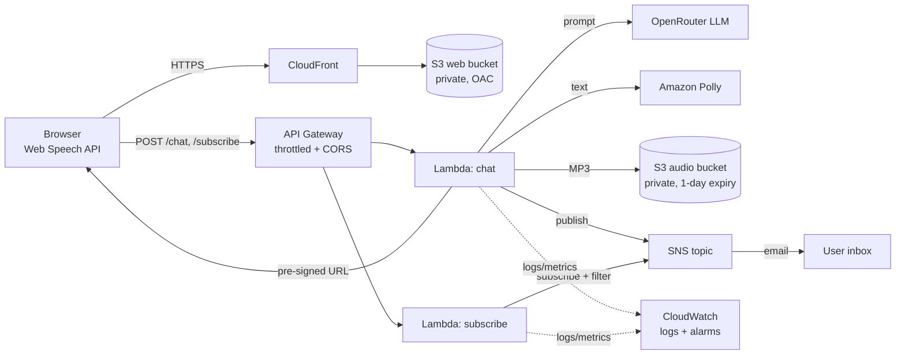

# AI-Powered Voice Chatbot (AWS Serverless)

A fully serverless, event-driven voice chatbot. Speak or type a question, get an LLM answer as text **and** spoken audio, and optionally receive the reply (with an audio link) by email.

**Stack:** API Gateway (HTTP API) · Lambda (Python 3.12) · OpenRouter LLM API · Amazon Polly · S3 · SNS · CloudFront · CloudWatch · AWS SAM

## Architecture



## Features
- Voice input (browser speech recognition) or typed input, with short conversation memory.
- LLM replies via OpenRouter, converted to MP3 by Polly (neural voice) and stored in S3; the browser plays it from a **pre-signed URL** (1 hour).
- Optional email notifications via SNS. Each subscriber gets a filter policy so they only receive **their own** replies.
- **Security:** both buckets private and encrypted; web served over HTTPS through CloudFront (Origin Access Control); least-privilege IAM per function; CORS locked to the site origin; API throttling; input validation.
- **Reliability/observability:** structured JSON logs (no message content), 14-day log retention, alarms on Lambda errors and p95 latency, graceful degradation (text is still returned if Polly fails), explicit 4xx/5xx error responses.

## Deploy

Prerequisites: AWS account, AWS CLI configured, [AWS SAM CLI](https://docs.aws.amazon.com/serverless-application-model/latest/developerguide/install-sam-cli.html), an [OpenRouter API key](https://openrouter.ai/keys).

```bash
export OPENROUTER_API_KEY=sk-or-...
export AWS_REGION=us-east-1          # any region where Polly neural voices are available
export ALERT_EMAIL=you@example.com   # optional: alarm notifications
./deploy.sh
```

The script builds and deploys the stack, writes `web/config.js` with your API URL, uploads the UI to S3, invalidates CloudFront and prints the site URL. Open it in Chrome, Edge or Safari (voice input needs HTTPS or localhost).

Tear down: empty both S3 buckets, then `sam delete --stack-name voice-chatbot`.

## API

| Method | Path | Body | Response |
|---|---|---|---|
| POST | `/chat` | `{"message": "...", "history": [{"role","content"}], "email": "optional"}` | `{"reply", "audio_url", "notified"}` |
| POST | `/subscribe` | `{"email": "..."}` | `{"message"}` (recipient must confirm via the SNS email) |

## Local tests and lint

```bash
pip install -r requirements-dev.txt
pytest -q
cfn-lint template.yaml
```

## Project structure

```
template.yaml            # all infrastructure (SAM/CloudFormation)
src/chat/app.py          # LLM + Polly + S3 + SNS logic
src/subscribe/app.py     # SNS email subscription
web/index.html, config.js
tests/test_handlers.py
deploy.sh
.github/workflows/ci.yml # pytest + cfn-lint on every push
```

## Cost and limits
Everything is pay-per-use; a demo costs cents per month. Audio files auto-delete after 1 day. LLM cost depends on the OpenRouter model (`ModelId` parameter). Messages are capped at 500 characters and API Gateway throttles to 5 req/s.

## Production hardening ideas
Move the API key to Secrets Manager, add AWS WAF/Cognito authentication, add a custom domain, and add an X-Ray tracing layer.

## License
MIT
